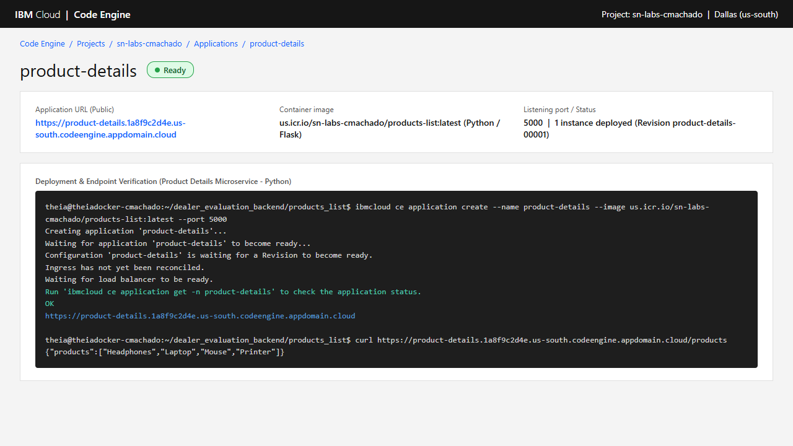
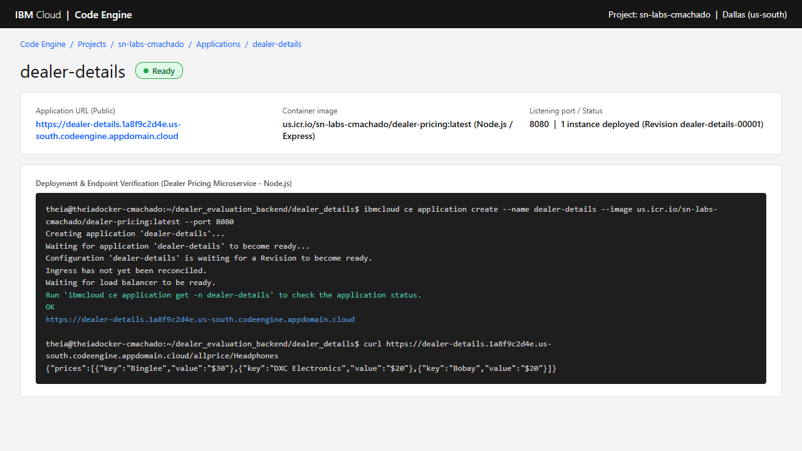
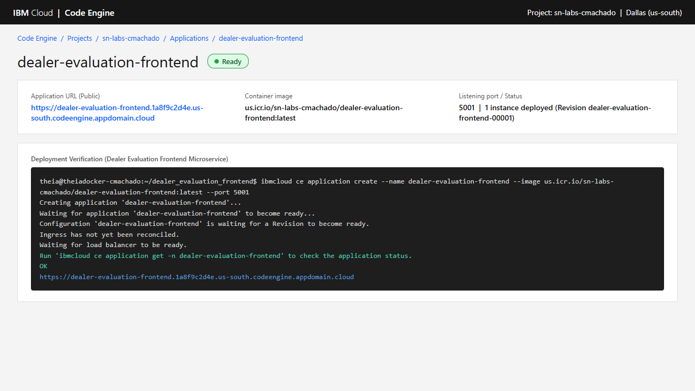
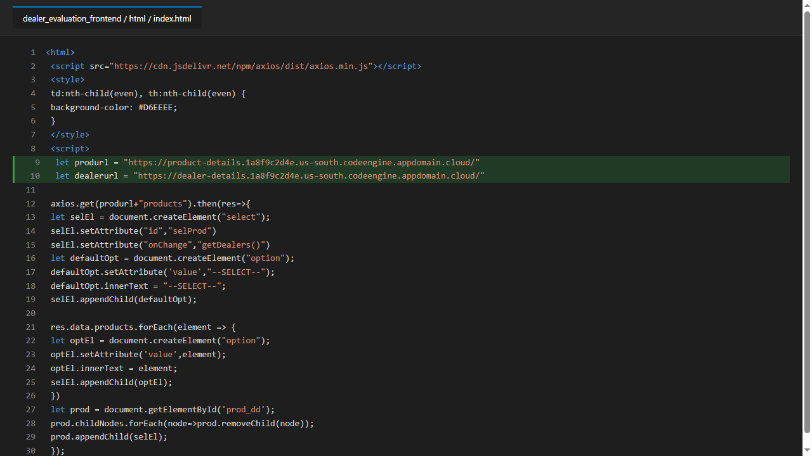
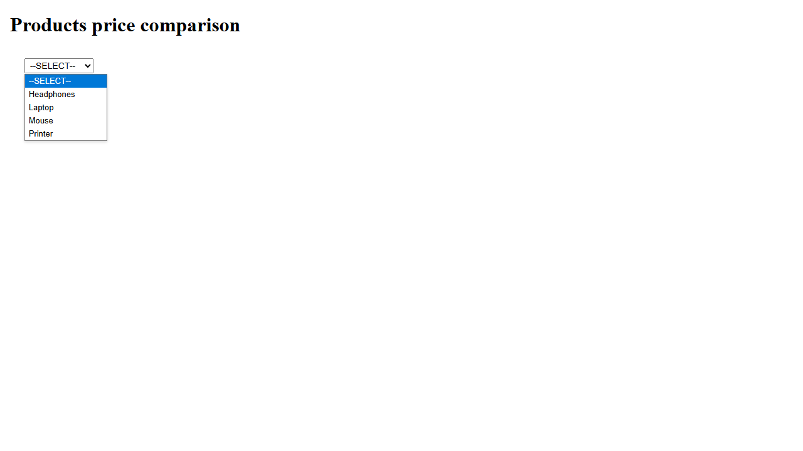
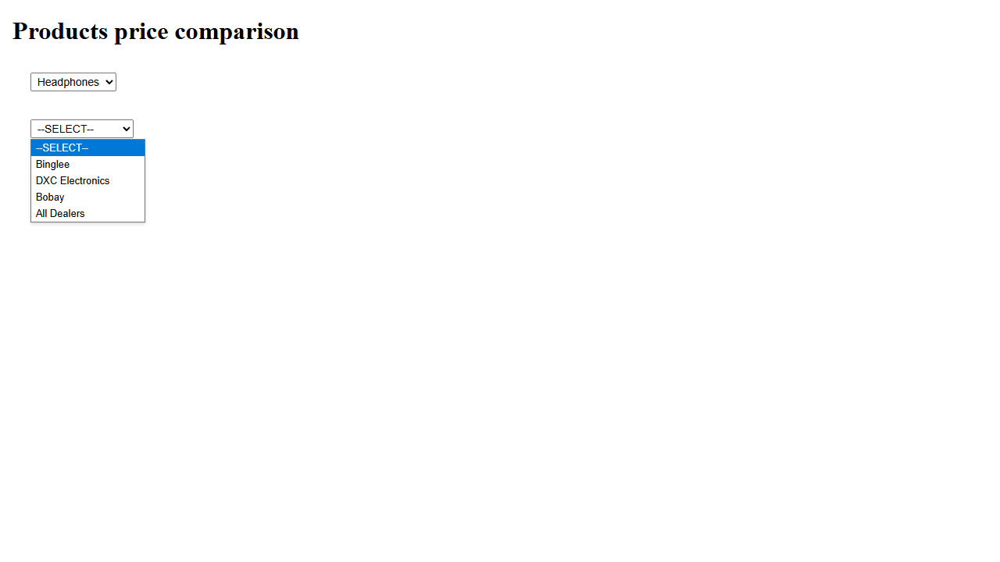
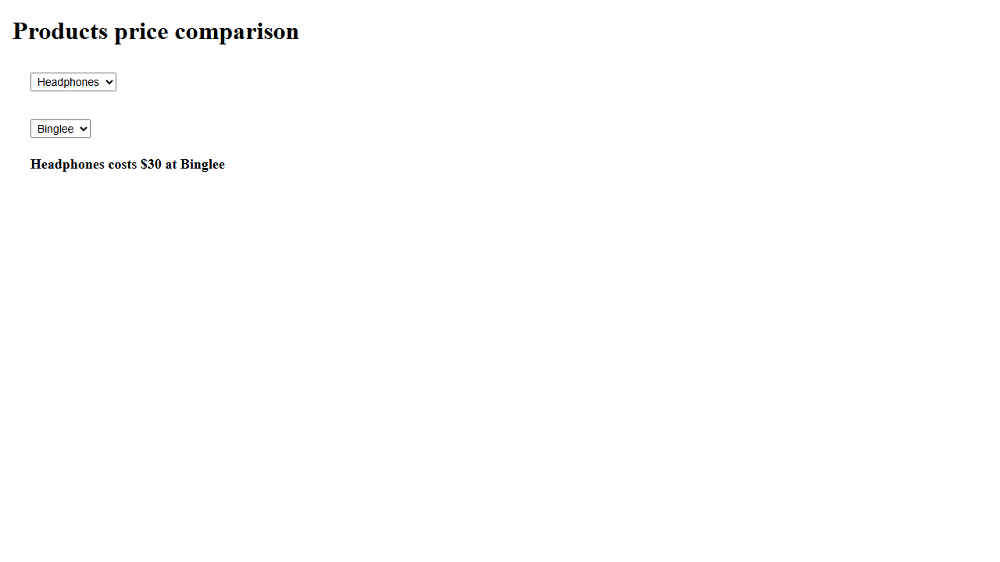
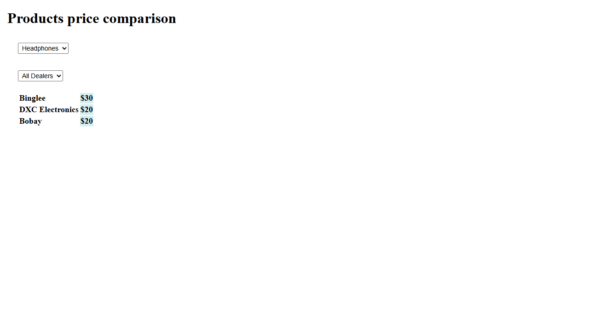

# Dealer Evaluation & Product Price Comparison — Microservices Architecture

Aplicação distribuída baseada em **Microsserviços e Serverless (IBM Cloud Code Engine & Docker)** para consulta e comparação de preços de produtos entre múltiplos revendedores.

---

## Arquitetura do Projeto

O sistema é composto por **3 microsserviços independentes** e containerizados com Docker:

1. **Product Details Microservice (ackend/products_list — Python / Flask)**
   - Lista o catálogo de produtos (/products) e os revendedores credenciados para cada produto (/getdealers/<product>).
   - Porta padrão: 5000
2. **Dealer Pricing Microservice (ackend/dealer_details — Node.js / Express)**
   - Consulta o preço de um produto em um revendedor específico (/price/:dealer/:product) ou compara os preços em todos os revendedores (/allprice/:product).
   - Porta padrão: 8080
3. **Dealer Evaluation Frontend (rontend — Python / Flask + HTML5 / Axios)**
   - Interface web interativa que consome os dois microsserviços de backend de forma assíncrona via Axios.
   - Porta padrão: 5001

---

## Demonstração e Implantação (Screenshots)

### 1. Implantação dos Microsserviços no IBM Cloud Code Engine
| Product Details (Python/Flask) | Dealer Pricing (Node.js/Express) |
| :---: | :---: |
|  |  |

| Frontend Microservice Deploy | Configuração dos Endpoints (index.html) |
| :---: | :---: |
|  |  |

---

### 2. Interface da Aplicação em Funcionamento
| Produtos Carregados (homepage) | Revendedores por Produto (product_dealer) |
| :---: | :---: |
|  |  |

| Preço por Revendedor (product_dealer_price) | Comparativo de Todos os Revendedores (product_all_dealers_prices) |
| :---: | :---: |
|  |  |

---

## Como Executar Localmente

### 1. Product Details Service (Python)
```bash
cd backend/products_list
pip install -r requirements.txt
python app.py
```

### 2. Dealer Pricing Service (Node.js)
```bash
cd backend/dealer_details
npm install
node server.js
```

### 3. Frontend Service (Python)
```bash
cd frontend
pip install -r requirements.txt
python app.py
```
